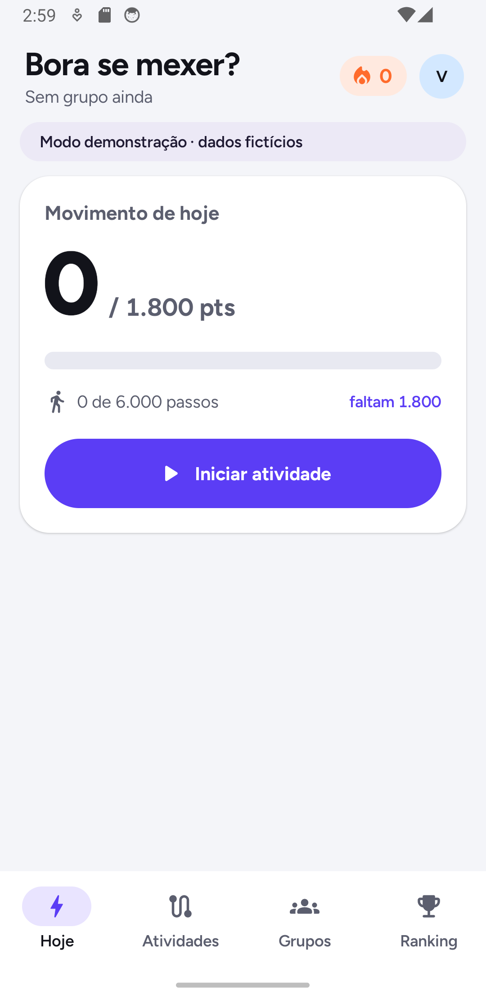
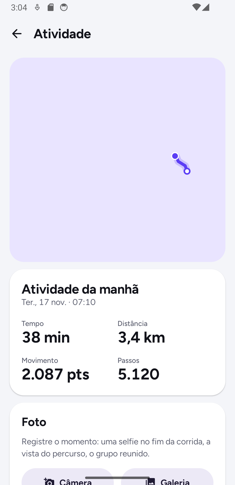
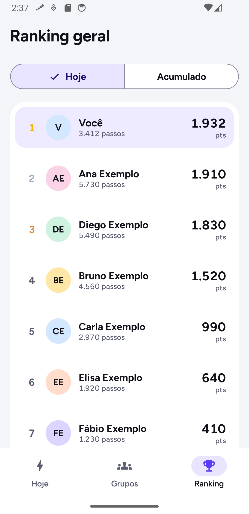

# Rodada

App Android de desafio de atividade física em grupo. O celular mede o quanto você se mexe pelo
acelerômetro e pelo contador de passos, cada dia em que você bate a meta vale um ponto e o grupo
disputa um ranking.

Projeto da disciplina **PM46S — Programação para Dispositivos Móveis** (UTFPR).

<p align="center">
  
  
  
  
</p>

## O que o app faz

- **Login só por rede social:** Google (Credential Manager), Facebook e Microsoft, todos via Firebase Auth.
- **Monitoramento em segundo plano:** um foreground service do tipo `health` lê o acelerômetro e o
  `TYPE_STEP_COUNTER`. A cada segundo o movimento vira um nível de 0 a 10, e uma leitura por minuto vai
  para o Firestore com nome do usuário, data e hora.
- **Meta diária:** o dia conta se bater a meta de pontos de movimento (padrão 1.800, cerca de 30 min de
  caminhada) **ou** a de passos (padrão 6.000). A sequência de dias aparece em laranja.
- **Grupos:** cada grupo é um desafio com período (ou sem fim), meta própria (Leve, Padrão ou Puxada) e
  código de convite. O ranking do grupo ordena por dias conquistados, com desempate pela intensidade acumulada.
- **Ranking individual:** de hoje e acumulado, entre todos os usuários.
- **Atividades:** cada "Iniciar → Parar" vira um treino com tempo, pontos, passos, distância e o percurso
  do GPS, desenhado com animação no Google Maps (ou num canvas, sem chave do Maps). Dá para anexar uma
  foto da câmera ou da galeria, guardada no aparelho em SQLite.
- **Modo demonstração:** sem `google-services.json`, o app roda com dados fictícios. Dá para abrir e
  navegar sem configurar nada.

## Stack

- Kotlin, Jetpack Compose e Material 3, sem XML de layout
- MVVM: `ViewModel` + `StateFlow<UiState>` + repositórios com coroutines
- Firebase Auth + Cloud Firestore (com cache offline no lugar de um buffer local)
- Google Maps Compose, Credential Manager, Facebook Login SDK
- Gradle Kotlin DSL com version catalog

## Estrutura

```
android/app/src/main/java/br/edu/utfpr/rodada/
├── data/      repositórios (Firebase e demonstração), modelos, regras de pontuação, fotos em SQLite
├── sensor/    ActivityMeter (sensor → nível) e MonitorService (foreground service)
└── ui/        telas, componentes (mapa do percurso, ranking, marca animada) e tema
firebase/firestore.rules   regras de segurança do Firestore
```

## Como rodar

```bash
cd android
./gradlew assembleDebug
```

Sem configuração extra o app abre em modo demonstração. Para ligar login real, Firestore e Maps, siga
o passo a passo em [COMO-RODAR.md](COMO-RODAR.md).

No emulador, `adb emu sensor set acceleration x:y:z` simula movimento.
